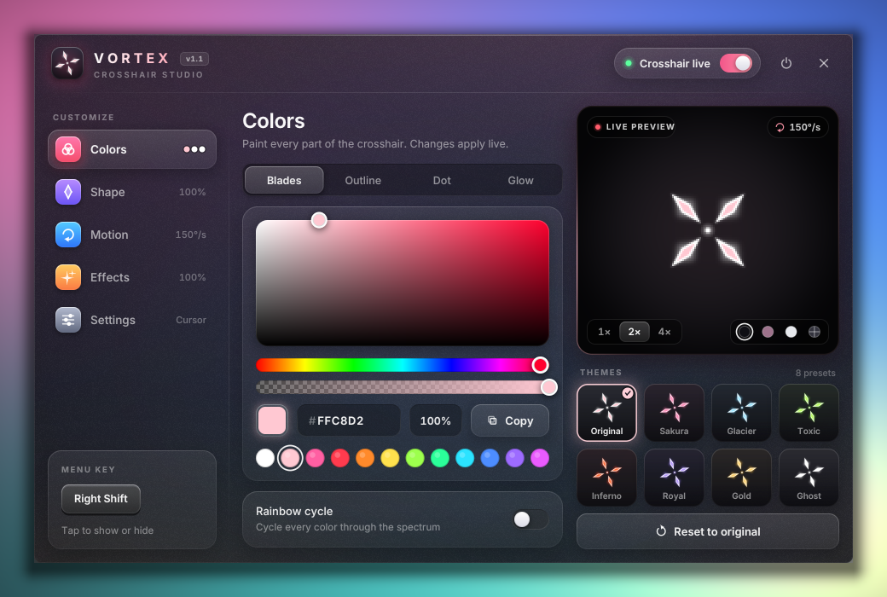
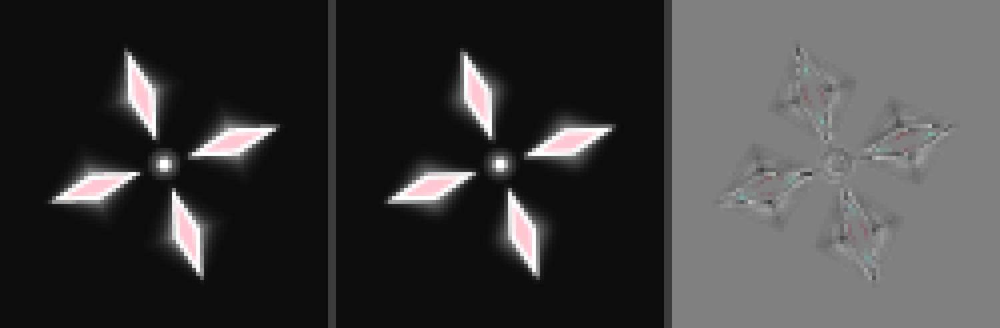

# Vortex Crosshair

A 1:1 clone of your spinning crosshair (four pink-and-white diamond blades, a white centre dot and a soft white glow) as a crosshair overlay for Windows. It sits on your mouse cursor, follows it, spins, and comes with a premium frosted-glass settings menu that you open with **Right Shift**.



## Download and run

1. Download **[`dist/VortexCrosshair.exe`](dist/VortexCrosshair.exe)**. It's a single file with nothing to install and no admin rights needed.
2. Double-click it. The crosshair appears on your cursor right away and the menu opens.
3. Tap **Right Shift** to show or hide the menu at any time. Holding Shift to type capital letters won't trigger it.
4. Vortex keeps running in the system tray. Left-click the tray icon to open the menu, or right-click it for *Show crosshair* and *Quit*.

> **Windows SmartScreen:** the exe isn't code-signed, so the first launch can show *"Windows protected your PC"*. Click **More info → Run anyway**.

### Games

- Use **Borderless** or **Windowed** display mode. Windows doesn't let any overlay draw over exclusive fullscreen.
- If a game runs as administrator, run Vortex as administrator too. Otherwise Windows blocks the hotkey while that game has focus.
- For FPS games, where the game locks and hides the cursor, set **Settings → Position → Screen center**.

## The clone

The crosshair was rebuilt from your screenshot pixel by pixel. A model of the shape was fitted to every pixel of the reference image (blade geometry, outline width, `#FFC8D2` core, centre dot, halo and the two glow layers). The renderer in the exe reproduces it with an average error of **0.67 / 255 per pixel** (RMSE 2.05).



*Left: your screenshot. Middle: Vortex rendered at the same angle. Right: the difference ×3 (flat grey means identical).*

`python3 tools/fit_reference.py` re-runs this check, and `--fit` redoes the model fit.

## Features

| Page | What you can change |
| --- | --- |
| **Colors** | Separate colours for blades, outline, centre dot and glow, using a saturation/value field, hue and alpha sliders, hex input (`#RRGGBB` or `#RRGGBBAA`), copy button and 12 quick swatches. *Rainbow cycle* is optional. |
| **Shape** | Size (50–400%), blade length, width, centre gap, outline thickness (or no outline), centre dot size, 2/3/4/5/6/8 blades |
| **Motion** | Spin on/off, speed (0–1080°/s) plus *Chill / Smooth / Fast / Turbo* presets, direction, and a click reaction (*Spin boost* or *Pulse* while you hold the mouse button) |
| **Effects** | Glow strength and spread, dot halo, contrast shadow (keeps it visible on bright scenes), opacity |
| **Settings** | Follow cursor or screen centre, X/Y nudge, hide the Windows cursor (the crosshair becomes your pointer), hide from screen capture (OBS, Discord, screenshots), start with Windows, rebind the menu key, and an optional show/hide-crosshair key |

The menu also has:
- a live, pixel-exact preview (1×/2×/4× zoom) on four test backgrounds (*Studio, Dusk, Snow, Grid*), framed by a slowly travelling light
- eight one-click themes: *Original, Sakura, Glacier, Toxic, Inferno, Royal, Gold, Ghost*
- a **Reset to original** button
- an accent colour that follows your crosshair colour: the aurora glow behind the glass, sliders, switches and the wordmark all re-tint when you change it
- colour-coded section icons with live values (size, spin speed, glow…), spring-animated switches and selectors, click ripples, tooltips, a staggered open animation and a "Saved" indicator

Settings save automatically to `%APPDATA%\VortexCrosshair\settings.ini`. Delete that file to go back to the defaults.

### How it stays on your cursor

The overlay is a click-through, always-on-top layered window that's redrawn once per monitor refresh. It wakes just before Windows composes each frame and reads the cursor position as late as possible, so it trails the real pointer by about one refresh instead of two. **Hide Windows cursor** hides the normal pointer so the crosshair takes its place. A small watchdog brings the normal pointer back even if Vortex is force-closed.

## Build from source

The app is plain C++17 and Win32, with a software renderer, no external dependencies, and a single static exe of about 0.8 MB. It cross-compiles from Linux with MinGW-w64:

```bash
sudo apt install g++-mingw-w64-x86-64-posix mingw-w64
./build.sh            # -> dist/VortexCrosshair.exe
./build.sh preview    # Linux tool that renders the menu to PNG (build/preview_ui out.png [page] [scale])
```

| Path | Contents |
| --- | --- |
| `src/crosshair.*` | the crosshair model and renderer (exact-area anti-aliasing and pre-computed glow field) |
| `src/canvas.*` | anti-aliased 2D rasteriser and text (stb_truetype with an embedded Inter subset) |
| `src/ui.*` | the glass settings panel (immediate-mode widgets, springs, ripples; static layers are cached so redraws stay cheap) |
| `src/settings.*` | settings, themes, INI persistence |
| `src/main_win32.cpp` | overlay thread, menu window (DWM acrylic/Mica), hotkeys, tray, autostart |

Fonts: Inter © The Inter Project Authors, SIL Open Font License 1.1 (`assets/fonts/OFL.txt`). `stb_truetype` / `stb_image_write` are public domain (Sean Barrett).
