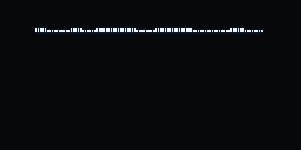

# XERA — Adaptive Curve Engine for Cronus Zen



*The Zen's 128×64 OLED while XERA runs. The script itself drew these frames in the GPC simulator.*

XERA replaces the fixed response curve on your aim stick with one that adapts every millisecond.
It reads where the stick is and how it is moving, then searches a library of 32,768
S-curves for the one that fits that moment. The winning curve glides in without a bump,
and the search starts again on the next millisecond.

- **Script:** [`XERA.gpc`](XERA.gpc). Paste it into Zen Studio, compile, and program it to a slot.
- **Built from** bit-packed state variables (BVARS), unsigned `const` lookup maps (UMAPS) and functions. There are **no combos**.
- **Screen:** XERA in scanline letters with a light band that sweeps across the name. A glint rides the divider and a sparkle finishes each sweep. A scan-beam boot plays when the script loads, and the screen stays up the whole time the script runs.

## Quick start

1. Open `XERA.gpc` in Zen Studio, compile (32-bit, which is the default), and program it to a slot.
2. In game, set the stick response curve to **Linear** (or the flattest option) and the **deadzone as low as it goes**. XERA provides both.
3. **Hold L2/LT and tap SHARE/VIEW** to turn the engine on or off. The tagline changes to `CURVE ENGINE OFF`, and the stick passes through untouched. The SHARE tap never reaches the game.

| Setting | Default | What it does |
|---|---|---|
| `XR_DEADZONE` | 4 | Inner deadzone in stick %. Raise it only if your stick drifts. |
| `XR_ANTI_DZ` | 0 | Anti-deadzone in output %. Use it when the game forces its own deadzone. |
| `XR_OUTER` | 100 | Stick % that counts as full deflection. |
| `XR_GAIN_PREC` / `TRACK` / `FLICK` | 65 / 100 / 190 | Local gain (% of 1:1) the curve aims for while micro-aiming, tracking and flicking. |
| `XR_DITHER` | 0 | Set to 1 for stochastic rounding, which averages finer than 1% output steps. |
| `XR_PROBES` | 6 | Neighbour curves scored per ms. Lower it if Zen Studio shows a high CPU load. |
| `XR_AIM_X/Y`, `XR_TOGGLE_*` | RX/RY, L2 + SHARE | Stick and toggle buttons. |

## How it works

Everything runs in Q12 fixed point (4096 = 1.0), with no floating point and no combos.

1. **State estimation.** An α-β tracking filter (α = 0.25, β = 0.027) runs at 1 kHz on each axis. It turns the 250 Hz integer controller reports into smooth position and velocity. It also gives the stick speed and the radial velocity: whether the stick is moving outward, inward or around.
2. **Intent.** Fuzzy memberships built from smoothstep blend three regimes:
   - **Precision:** slow movement near the centre.
   - **Flick:** fast, outward movement. It has a 4 ms attack and a 6 ms release.
   - **Tracking:** everything else.
3. **The curve library.** Every candidate is a *dual-rational S-curve*, built from two Schlick bias segments joined at a knee `p` with matched slope:

   ```
   f(t) = q·B(t/p ; a)                    t < p     (convex precision zone)
   f(t) = q + (1−q)·B((t−p)/(1−p) ; b)    t ≥ p     (concave speed zone)
   B(u ; s) = u / ((1/s − 2)(1 − u) + 1)
   q = K·p / (A(1−p) + K·p),   A = (1−a)/a,   b = K/(1+K)
   ```

   The library has 32 knee positions × 32 precision depths × 32 knee drives = **32,768 curves**. Each curve's ID is packed into one 15-bit BVAR. Every curve is monotone and C1-smooth, and has a true inflection point. The knee gain is always at least **2.25×** the centre gain and **1.56×** the top gain. So no curve is linear, and none bends only one way the way an expo curve does.
4. **Cost of a curve** (lower is better). It adds three terms:
   - the error between the curve's gain at your current stick position and the gain the intent calls for;
   - during flicks, the error along the path the stick is predicted to take over the next 24 ms;
   - a small pull toward the intent's home shape, which keeps the problem well-posed.
5. **Search.** Each millisecond a compass (pattern) search scores the current best curve, 6 lattice neighbours and the intent's home curve. It moves to the best of them and halves its step when nothing improves. When the intent shifts it widens the search again.
6. **Glide.** The winning curve's parameters pass through a two-stage, critically damped glide. It is fast during flicks (3 ms) and slow while you hold (16 ms), so the output never jumps under your thumb.
7. **Output.** The curve is applied to the stick's radial magnitude, so your aim direction is kept exactly. The deadzone is scaled, so leaving it causes no jump. The output is rounded to the nearest unit (or stochastically rounded when `XR_DITHER` is 1).

**About "thousands of curves every millisecond":** the Zen's GPC virtual machine cannot score thousands of curves in 1 ms. Even if it could, the stick would lag. XERA scores 7–8 curves each millisecond, which is roughly 7,400 per second. Because each search starts from the previous best curve, it reaches the curve an exhaustive scan of all 32,768 would pick. In testing it found **exactly the same curve 98.5% of the time**, usually within 4 ms (8 ms at the 95th percentile).

## Verification

I couldn't compile the script in Zen Studio here; that is the one step still to do on your PC. Instead,
[`tools/verify_xera.py`](tools/verify_xera.py) runs the script in a strict GPC interpreter
([`tools/gpc_sim.py`](tools/gpc_sim.py)). The interpreter enforces global-only variables, no recursion,
32-bit overflow traps and C-style division, and emulates the Zen's I/O and 128×64 OLED. It compares the
script against a bit-exact reference model ([`tools/xera_model.py`](tools/xera_model.py)).

```
python3 tools/verify_xera.py            # 20 checks, about 1 minute
python3 tools/verify_xera.py --preview  # also re-renders the GIF and PNG
```

| Check | Result |
|---|---|
| Script output vs reference model | 0 differences over 7,800 ms of realistic aiming and 20,000 ms of random fuzzing (corners, jumps, late ticks) |
| Integer safety | no int32 overflow and no division by zero anywhere |
| Curve library | all 32,768 curves are monotone, with f(0)=0 and f(1)=1; fixed-point error ≤ 0.08% of full scale |
| Search vs exhaustive scan | same curve in 98.5% of 600 runs; 4 ms median to converge |
| Tracking consistency | the same stick position gives the same output within 0.54% while sweeping |
| Holding still | the curve moves 0.00% during a steady hold |
| Flicks | 8.3% average output lead during the flick (18% at peak); output settles within 2% about 26 ms after the stick stops |
| Ramps | pushing the stick further never lowers the output by more than 0.1% (less than one output unit) |
| OLED | 2,583 flash frames and the idle screen are pixel-exact against the design; the ON/OFF tagline swaps correctly |
| Cost | about 3,100 interpreter operations per tick on average; at most 30 OLED calls in a single tick |

Two things still need checking on real hardware:

- **Zen Studio compile.** If it reports anything, send me the message and I'll fix it.
- **CPU load at 1 ms.** If the load is high, lower `XR_PROBES` to 4 or 3. The built-in governor also steps down automatically when ticks keep running late. Every filter is frame-rate independent, so the feel stays the same at a 2 ms tick.

## Files

| File | Purpose |
|---|---|
| `XERA.gpc` | the script |
| `xera_oled_preview.gif`, `xera_oled_still.png` | the OLED animation, rendered from the script's own drawing calls |
| `tools/gpc_sim.py` | strict GPC interpreter with OLED emulation |
| `tools/xera_model.py` | bit-exact reference engine, curve library, logo and font design |
| `tools/verify_xera.py` | the verification suite above |
